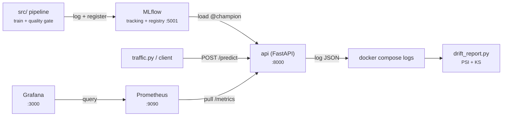

# Lab Day 47 — Building and Monitoring ML Pipelines

> Panduan langkah demi langkah. Kalau kamu tidak ikut kelas, file ini cukup untuk menyelesaikan lab sendiri.
> Perintah ditulis untuk **Windows PowerShell** dan **macOS/Linux**. Kalau hanya ada satu versi, perintahnya sama untuk keduanya.

Hari ini kamu mengubah API harga rumah Day 46 (FastAPI + Docker) menjadi sistem MLOps kecil yang lengkap:



| Bagian | Isi | TODO | Waktu di kelas |
|---|---|---|---|
| 0 | Nyalakan stack (MLflow, API, Prometheus, Grafana) | – | 9 menit |
| 1 | Pipeline modular + MLflow tracking + quality gate | 1–4 | 17 menit |
| 2 | Model registry → API, promote, rollback | 5–6 | 16 menit |
| 3 | Log JSON, metrik Prometheus, dashboard Grafana, drift report | 7–9 | 17 menit |

Folder:

- `starter/` — yang kamu kerjakan (berisi `TODO 1` … `TODO 9`; setiap TODO yang belum diisi memberi pesan error yang jelas saat dipanggil, bukan diam-diam salah).
- `solution/` — jawaban lengkap yang sudah diuji. Dipakai sebagai **cadangan**: kalau mentok, salin satu file dari sini lalu lanjut.

---

## Persiapan (WAJIB sebelum kelas: ±30 menit, download ±1,5 GB, ruang disk ±5 GB)

1. **Docker Desktop** terpasang dan sedang berjalan (Windows: backend WSL2). Cek: `docker version` dan `docker compose version`.
2. **Python 3.11** + **VS Code**. Cek: `python --version` (Windows bisa juga `py -3.11 --version`).
3. Unduh materi dari link hands-on, lalu buka folder `lab/starter` di VS Code (File → Open Folder).
4. Buat virtual environment dan install dependency (di folder `lab/starter`):

   Windows PowerShell:
   ```powershell
   py -3.11 -m venv .venv
   .venv\Scripts\activate
   python -m pip install -r requirements.txt
   ```
   macOS / Linux:
   ```bash
   python3.11 -m venv .venv
   source .venv/bin/activate
   python -m pip install -r requirements.txt
   ```
   Kalau PowerShell menolak menjalankan `activate` ("running scripts is disabled"), jalankan sekali:
   `Set-ExecutionPolicy -Scope CurrentUser RemoteSigned`, lalu ulangi.

5. **Tarik image dan build API sekarang** (ini yang paling lama; jangan dilakukan di kelas):
   ```
   docker compose pull
   docker compose build
   ```
   Ukuran download (terkompresi): `ghcr.io/mlflow/mlflow:v3.18.0` ±300 MB, `grafana/grafana:13.2.6` ±490 MB,
   `prom/prometheus:v3.15.1` ±115 MB, `python:3.11-slim` ±45 MB, plus paket pip untuk build API.
   Setelah diekstrak, semua image memakan ±4 GB disk (image API sendiri ±0,7 GB).

Checklist singkat: `docker compose config -q` tidak error · `python -c "import mlflow, sklearn; print('ok')"` mencetak `ok` (venv aktif).

### Port yang dipakai

| Service | Alamat | Ganti port lewat `.env` |
|---|---|---|
| API (FastAPI) | http://localhost:8000/docs | `API_PORT` |
| MLflow UI | http://localhost:5001 | `MLFLOW_PORT` (lalu set juga env `MLFLOW_TRACKING_URI`) |
| Prometheus | http://localhost:9090 | `PROMETHEUS_PORT` |
| Grafana | http://localhost:3000/d/harga-rumah (dashboard, tanpa login; admin/admin untuk edit) | `GRAFANA_PORT`, `GRAFANA_ADMIN_PASSWORD` |

MLflow sengaja di 5001, bukan 5000 (di macOS port 5000 dipakai AirPlay). Semua port hanya dibuka di `127.0.0.1`
(tidak bisa diakses orang lain di WiFi yang sama). Untuk mengganti port: salin `.env.example` menjadi `.env`
(`Copy-Item .env.example .env` di PowerShell, `cp .env.example .env` di macOS) lalu edit angkanya.

---

## Bagian 0 — Nyalakan stack (9 menit)

1. **Matikan container Day 46** kalau masih jalan (dia memakai port 8000). Di folder repo Day 46 (`dsml43-day46-docker-ml-app`): `docker compose down`, lalu `docker rm -f harga-api` kalau container dari Bagian B masih ada.
2. Di folder `lab/starter`, venv aktif, buat tiga dataset (sintetis, deterministik):
   ```
   python make_dataset.py
   python make_dataset.py --scenario live --n 500 --out data/live_normal.csv
   python make_dataset.py --scenario drift --n 500 --out data/live_drift.csv
   ```
   `train.csv` = data training (2000 baris). `live_normal.csv` = data "produksi" yang mirip training.
   `live_drift.csv` = data "tiga bulan kemudian": rumah lebih jauh dari pusat kota, lebih banyak di Bogor/Bekasi,
   dan harga pasar naik 18%.
3. Nyalakan semua service:
   ```
   docker compose up -d --build
   docker compose ps
   ```
4. Buka di browser: MLflow http://localhost:5001 · Grafana http://localhost:3000/d/harga-rumah · API http://localhost:8000/docs

**Checkpoint 0** — `docker compose ps` menunjukkan `mlflow`, `api`, `prometheus`, `grafana` berstatus Up.
http://localhost:8000/health menjawab kira-kira:
```json
{"status":"degraded","model_name":"harga-rumah","model_alias":"champion","model_version":null,
 "detail":"NotImplementedError: TODO 5: muat model @champion dari MLflow Registry (app/model_loader.py)"}
```
Itu **benar**: belum ada model dan TODO 5 belum diisi. API sengaja tetap hidup (status `degraded`, `/predict` menjawab 503)
— beda dengan Day 46 yang langsung crash kalau `model.joblib` tidak ada.

> **Cadangan Bagian 0:** kalau build di `starter/` gagal, jalankan stack dari `solution/`
> (`cd ../solution` → buat data → `docker compose up -d --build`). Nama project compose sama (`day47-mlops`),
> jadi nanti bisa kembali ke `starter/` tanpa bentrok port.

---

## Bagian 1 — Pipeline + MLflow + quality gate (TODO 1–4, 17 menit)

Struktur pipeline (`src/`):

| File | Tugas |
|---|---|
| `config.yaml` + `src/config.py` | Semua angka keputusan di satu file (path, test_size, hyperparameter, batas MAE, alamat MLflow). Env var menang atas file. |
| `src/data.py` | Load CSV → **validasi** (kolom wajib, null, luas/harga > 0, kota dikenal) → split dengan seed tetap |
| `src/evaluate.py` | MAE, RMSE, R² + **quality gate** |
| `src/train.py` | Orkestrasi: data → train → evaluate → gate → log ke MLflow → daftarkan ke registry → set alias |
| `src/registry.py` | Helper alias / reload API (sudah jadi) |

Kerjakan TODO berikut (buka file, cari tulisan `TODO`):

- **TODO 1 — `src/data.py`**: tambahkan dua pemeriksaan: `harga <= 0` dan `kota` di luar daftar `KOTA`.
- **TODO 2 — `src/train.py`**: catat ke MLflow: `mlflow.log_params(...)`, `mlflow.set_tags(...)` (git_sha, data_hash, max_mae), dan `mlflow.log_metrics(metrics)`.
- **TODO 3 — `src/evaluate.py`**: kalau `metrics["mae"] > max_mae` → `raise QualityGateError(...)`. **Raise, bukan print** — supaya pipeline yang dijalankan scheduler benar-benar berhenti (exit code 1).
- **TODO 4 — `src/train.py`**: simpan & daftarkan model:
  ```python
  info = mlflow.sklearn.log_model(
      pipe,
      name="model",
      registered_model_name=cfg.model_name,
      input_example=X_train.head(3),
      signature=infer_signature(X_train, pipe.predict(X_train)),
      skops_trusted_types=TRUSTED_TYPES,
  )
  ```
  Catatan MLflow 3.18: argumennya `name=` (tutorial lama memakai `artifact_path=`). Model sklearn disimpan dengan
  format **skops** yang aman (pickle bisa menjalankan kode sembarang saat dibuka); pohon RandomForest harus dinyatakan
  "dipercaya" lewat `skops_trusted_types`.

Jalankan dua kali:
```
python -m src.train
python -m src.train --max-depth 3
```

Output yang diharapkan (angka dari run verifikasi):
```
Run 'rf100-depthNone-mf1.0': MAE Rp 251,1 jt | RMSE Rp 436,7 jt | R2 0.892
[GATE LOLOS] MAE <= Rp 300,0 jt -> terdaftar sebagai harga-rumah v1 (@challenger)
             Belum ada champion -> v1 langsung jadi @champion

Run 'rf100-depth3-mf1.0': MAE Rp 408,5 jt | RMSE Rp 629,7 jt | R2 0.776
[GATE GAGAL] MAE Rp 408,5 jt > batas Rp 300,0 jt
             Model TIDAK didaftarkan. Run tetap tercatat di MLflow (status FAILED).
```
(MLflow juga mencetak baris "View run … at: http://localhost:5001/…" — klik untuk membuka run-nya.)

Buka MLflow UI → **Experiments → prediksi-harga-rumah**: centang dua run → **Compare**. Lalu menu **Models → harga-rumah**:
ada **Version 1** dengan alias `@champion` dan `@challenger`. Coba juga
`python -m src.train --max-mae 100000000` (batas Rp 100 jt) — model yang sama pun ditolak.

**Checkpoint 1** — 2 run (FINISHED + FAILED), registry `harga-rumah` v1 `@champion`, MAE Rp 251,1 jt.

> **Cadangan Bagian 1:**
> ```
> cp ../solution/src/data.py src/
> cp ../solution/src/train.py src/
> cp ../solution/src/evaluate.py src/
> ```
> (`cp` jalan di PowerShell maupun bash.) Lalu jalankan ulang `python -m src.train`.
>
> **Python lokal bermasalah?** Jalankan perintah yang sama *di dalam container* (memakai kode & data dari folder ini):
> `docker compose run --rm trainer python -m src.train` — berlaku juga untuk semua `python scripts/...` di bawah.

---

## Bagian 2 — Registry → API, promote, rollback (TODO 5–6, 16 menit)

- **TODO 5 — `app/model_loader.py`**: ganti cara Day 46 (`joblib.load(MODEL_PATH)` + versi diketik tangan) dengan registry:
  ```python
  client = MlflowClient()                                   # alamat dari env MLFLOW_TRACKING_URI
  mv = client.get_model_version_by_alias(name, alias)       # "@champion itu versi berapa?"
  model = mlflow.pyfunc.load_model(f"models:/{name}/{mv.version}")
  return LoadedModel(model=model, version=str(mv.version), run_id=mv.run_id)
  ```
  Di dalam compose, API memanggil MLflow di `http://mlflow:5000` (nama service = hostname). Model diunduh lewat
  server MLflow (artifact proxy), bukan lewat folder di laptop.

Build ulang API (cepat, ±10 detik, karena layer `pip install` ter-cache) lalu smoke test:
```
docker compose up -d --build api
python scripts/smoke_test.py
```
Harus diakhiri `SMOKE TEST LULUS`. Coba juga Swagger UI http://localhost:8000/docs → `POST /predict` → Try it out.
Request-nya sama persis dengan Day 46; response kini juga berisi `model_version` dan `request_id`.

Latih model kedua, lalu promosikan:
```
python -m src.train --n-estimators 200 --max-features 0.5
python scripts/promote.py
```
```
Champion  v1: MAE Rp 251,1 jt
Kandidat  v2: MAE Rp 245,8 jt
[OK] @champion: v1 -> v2

Registry 'harga-rumah':
  v1   MAE Rp 251,1 jt    @previous
  v2   MAE Rp 245,8 jt    @challenger @champion
[OK] API sekarang melayani v2  (cek: http://localhost:8000/health)
```
`promote.py` membandingkan MAE di test set yang **sama**, menolak kandidat yang lebih buruk (kecuali `--force`),
menyimpan champion lama sebagai `@previous`, menulis tag `promoted_at` + alasan, lalu memanggil `POST /admin/reload`
dan memastikan `/health` melaporkan versi baru. Tidak ada build ulang image.

- **TODO 6 — `scripts/rollback.py`**: satu baris yang memindahkan alias (contoh lengkap ada di `promote.py`):
  `client.set_registered_model_alias(name, "champion", target)`

```
python scripts/rollback.py --reason "latihan rollback"
```
```
[OK] ROLLBACK @champion: v2 -> v1
...
[OK] API sekarang melayani v1
```
Di laptop verifikasi, promote dan rollback masing-masing selesai ±1 detik (termasuk reload API).

Bonus: `python -m src.train --n-estimators 20` (MAE Rp 256,9 jt, lolos gate) lalu `python scripts/promote.py`
→ `[DITOLAK] Kandidat lebih buruk dari champion.`

**Checkpoint 2** — `/health` menunjukkan `"model_version":"2"` setelah promote dan `"1"` setelah rollback.
MLflow → Models → harga-rumah: v1 `@champion`, v2 `@previous` (+ `@challenger`).

> **Cadangan Bagian 2:** `cp ../solution/app/model_loader.py app/` dan `cp ../solution/scripts/rollback.py scripts/`,
> lalu `docker compose up -d --build api`.

---

## Bagian 3 — Log JSON, metrik, dashboard, drift (TODO 7–9, 17 menit)

- **TODO 7 — `app/main.py`**: satu baris log JSON per request:
  ```python
  log.info("prediction", extra={"fields": {
      "request_id": request_id,
      "model_version": current.version,
      "features": features.model_dump(),
      "prediction": round(harga),
      "latency_ms": latency_ms,
  }})
  ```
- **TODO 8 — `app/main.py`**: catat metrik Prometheus (definisinya di `app/metrics.py`):
  ```python
  PREDICTIONS.labels(model_version=current.version).inc()
  PREDICTED_PRICE.observe(harga)
  FEATURE_JARAK.observe(features.jarak_ke_pusat_km)
  ```
  (Request count & latency semua endpoint sudah dicatat oleh middleware `observe_requests`.)

Build ulang, kirim trafik "normal", lalu buka dashboard Grafana **Harga Rumah - Model Monitoring** di
http://localhost:3000/d/harga-rumah (tanpa login, refresh otomatis tiap 5 detik):
```
docker compose up -d --build api
python scripts/traffic.py --scenario live --n 300 --invalid 0.05
docker compose logs api --no-log-prefix --tail 3
```
`--invalid 0.05` sengaja mengirim 5% request rusak (kota "Surabaya") → terlihat sebagai status 422 di Grafana.
Contoh satu baris log (aslinya satu baris):
```json
{"ts": "2026-11-24T10:46:47.466+00:00", "level": "INFO", "logger": "api", "event": "prediction",
 "request_id": "22678307c8fd", "model_version": "1", "features": {"luas_tanah_m2": 120, ..., "kota": "Depok"},
 "prediction": 1873990000, "latency_ms": 37.83}
```

Sekarang kirim trafik **drift** selama ±2 menit (biarkan jalan; buka terminal kedua untuk langkah berikutnya):
```
python scripts/traffic.py --scenario drift --n 600 --rate 5
```
Amati:
- Grafana → panel **Drift watch**: rata-rata `jarak_ke_pusat_km` naik dari ±19 km ke ±34 km, melewati garis putus-putus 28 km.
- Grafana → panel **Harga prediksi**: rata-rata prediksi justru *turun* (rumah lebih jauh → model menebak lebih murah),
  padahal harga asli naik 18%. Dashboard tanpa label tidak bisa melihat concept drift.
- Prometheus http://localhost:9090 → **Alerts**: `DriftJarakKePusat` berubah `pending` → `firing` (±1–2 menit).

- **TODO 9 — `scripts/drift_report.py`**: lengkapi rumus PSI (3 baris terakhir fungsi `psi`):
  ```python
  ref_pct = np.clip(ref_pct, 1e-4, None)  # hindari log(0)
  cur_pct = np.clip(cur_pct, 1e-4, None)
  return float(np.sum((cur_pct - ref_pct) * np.log(cur_pct / ref_pct)))
  ```

```
python scripts/drift_report.py --current data/live_normal.csv
python scripts/drift_report.py --current data/live_drift.csv
```
Hasil yang diharapkan untuk data drift:
```
fitur                  rata-rata ref -> sekarang      p-value     PSI  status
------------------------------------------------------------------------------
luas_tanah_m2          132.3 -> 131.8 (-0%)              0.64   0.035  AMAN
...
jarak_ke_pusat_km      19.4 -> 34.2 (+76%)            6.8e-78   2.290  DRIFT
umur_bangunan_tahun    20.7 -> 19.3 (-7%)               0.081   0.032  AMAN
kota                   (kategori: proporsi kota)      1.1e-19   0.254  DRIFT
------------------------------------------------------------------------------
Ringkasan: 2 fitur DRIFT, 0 WASPADA
MAE champion v1: test set Rp 251,1 jt -> data ini Rp 435,9 jt (1.74x)
```
Data normal: 0 DRIFT, MAE Rp 244,5 jt (0.97x), exit code 0. Data drift: exit code 1 (bisa dipakai sebagai pemicu
retraining/alert). Cek exit code: PowerShell `echo $LASTEXITCODE` · macOS `echo $?`.

Bonus — laporan drift langsung dari log API:
```
docker compose logs api --no-log-prefix > logs/api.jsonl
python scripts/drift_report.py --current logs/api.jsonl --no-model
```
(Di Windows PowerShell 5, `>` menyimpan file sebagai UTF-16; script sudah menanganinya.)

**Checkpoint 3** — Grafana menampilkan request rate, p95 latency, error rate 0%, versi model; panel jarak naik ke ±34 km;
alert `DriftJarakKePusat` firing; `drift_report` data drift: 2 fitur DRIFT, exit code 1.

> **Cadangan Bagian 3:** `cp ../solution/app/main.py app/` dan `cp ../solution/scripts/drift_report.py scripts/`,
> lalu `docker compose up -d --build api`.

---

## Selesai: bersih-bersih

```
docker compose down          # matikan container; data MLflow/Grafana/Prometheus tetap tersimpan di volume
docker compose down -v       # matikan + HAPUS semua data (registry, run, dashboard state)
```
Kalau mau memakai stack ini untuk assignment, cukup `docker compose down` (tanpa `-v`).

---

## Troubleshooting

| Gejala | Penyebab & solusi |
|---|---|
| `Bind for 127.0.0.1:8000 failed: port is already allocated` | Container Day 46 (atau aplikasi lain) masih memakai port. `docker compose down` di folder Day 46, atau isi `API_PORT=8001` di `.env` lalu pakai `--url http://localhost:8001` / env `API_URL`. |
| `Connection refused` / `Max retries exceeded ... localhost:5001` saat `python -m src.train` | Container `mlflow` belum Up/healthy (`docker compose ps`), atau `MLFLOW_PORT` diganti tanpa set `MLFLOW_TRACKING_URI`. PowerShell: `$env:MLFLOW_TRACKING_URI="http://localhost:5002"`. |
| `NotImplementedError: TODO n ...` | TODO nomor n belum diisi (atau baris `raise NotImplementedError` belum dihapus). |
| `/health` tetap `degraded` setelah TODO 5 | Belum rebuild: `docker compose up -d --build api`. Atau belum ada `@champion` (jalankan Bagian 1), lalu `python scripts/smoke_test.py` atau `POST /admin/reload`. |
| MLflow menjawab **403** "Rejected request with invalid Host header" (log container mlflow) | MLflow 3.x memblokir host selain localhost/IP privat. Compose lab sudah memakai `--allowed-hosts mlflow:5000,localhost:*,127.0.0.1:*`. Kalau kamu menulis compose sendiri, tambahkan flag ini. |
| `MlflowException: ... untrusted types ... sklearn.tree._tree.Tree` | Lupa `skops_trusted_types=TRUSTED_TYPES` di `log_model` (TODO 4). |
| `TypeError ... unexpected keyword argument 'name'` di `log_model` | Versi MLflow lama di venv. Pastikan venv aktif & `pip install -r requirements.txt` (mlflow-skinny 3.18.0). |
| Grafana "No data" | Belum ada trafik, TODO 8 belum diisi/rebuild, atau target Prometheus DOWN (cek http://localhost:9090/targets). |
| PowerShell: "running scripts is disabled on this system" | `Set-ExecutionPolicy -Scope CurrentUser RemoteSigned` |
| `docker compose pull` sangat lambat | Lakukan sebelum kelas; pakai jaringan lain. Saat kelas: ikuti layar mentor, kerjakan TODO, jalankan di rumah. |
| `pip install` gagal di Windows (compiler / wheel) | Pastikan Python **3.11** 64-bit (`py -3.11`). Semua dependency punya wheel untuk 3.11. Alternatif: jalur container `docker compose run --rm trainer ...`. |
| Laptop berat / RAM penuh | Stack ini memakai ±1,2 GB RAM (MLflow ±450 MB, API ±300 MB, Grafana ±350 MB, Prometheus ±90 MB). Tutup aplikasi lain; di Docker Desktop alokasikan ≥ 4 GB memory. |
